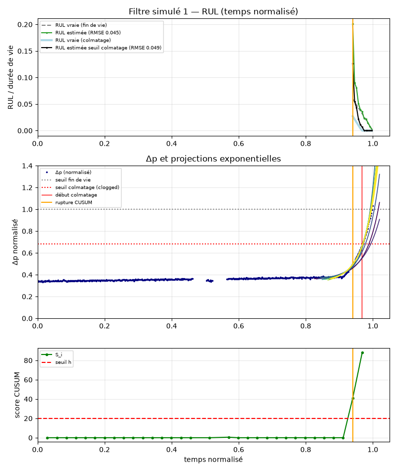

# CUSUM + RUL pour filtres à huile moteur

Implémentation Python de la méthode décrite dans l'article :

> J.-P. Noot, M. Martin, E. Birmele,
> **« Change point detection method for estimating the remaining useful lifetime of engine filters »**,
> *31st CIMAC World Congress 2025*, Zürich, 19–23 mai 2025, Paper No. 471.
> Liebherr Components Colmar / Université de Strasbourg.
> HAL : <https://hal.science/hal-05212213/> — DOI [10.5281/zenodo.15517911](https://doi.org/10.5281/zenodo.15517911)

Ce code a été réécrit à partir de l'article. Il n'est **pas** le code
original et peut différer sur certains détails (voir « Écarts »).

## Principe

1. **Détection du point de changement (CUSUM de pente)** — `cusum_rul.py`, `CusumDetector`
   Le temps est découpé en fenêtres. Sur chaque fenêtre, on compare le modèle M0 (pente nulle) au modèle M1
   (pente ≥ `alpha_ref`) par un score de log-vraisemblance `s_i = log(L1/L0)`. La somme cumulée
   `S_i = max(S_{i-1} + s_i, 0)` dépasse un seuil `h` lorsque Δp entre en phase de colmatage (phase 3).
2. **RUL par ajustement exponentiel contraint** — `RulEstimator`
   Après le point de changement, ajustement de `Δp(t) = a·exp(b·(t/c_norm)²) + c` (`a, b ≥ 0`) sur les
   premiers et derniers points ; la RUL est le temps restant avant que le seuil de colmatage soit atteint.
   Moyenne des 6 meilleurs ajustements sur 10 initialisations aléatoires.

Extensions par rapport à l'article : `n_exceed` (nombre de fenêtres consécutives au-dessus du seuil avant de
valider la rupture), fenêtres coupées aux **redémarrages** (qui créent des chutes et des décalages de niveau
sans rapport avec le colmatage), nettoyage des chutes transitoires (`prep.py`).

## Installation et démo (données simulées)

```bash
pip install -r requirements.txt
python examples/demo_simulated.py      # génère images/simulated_*.png
```



Exemple sur un filtre **simulé** (axes normalisés).

## Résultats sur données réelles

Des exemples de résultats obtenus sur des données Liebherr (six filtres d'huile, bancs d'essai) sont présentés
dans l'article cité ci-dessous (section 5). Ni ces données ni les figures correspondantes ne sont publiées ici.

## Utiliser vos propres données

```bash
python run_on_your_data.py --csv mes_donnees.csv --id-col filter_id --time-col time \
    --dp-col delta_p --stamp-col timestamp --stable-col stable --clogged-col clogged --ids 1 2 3
```

Un CSV avec une ligne par mesure suffit (identifiant du filtre, heures moteur, Δp ; horodatage, régime
stable et indicateur de colmatage sont optionnels). Les paramètres (`--alpha-ref`, `--window`, `--threshold`,
`--n-exceed`) sont à régler sur vos propres points de rupture annotés.

## Structure

| Fichier | Rôle |
|---|---|
| `cusum_rul.py` | CUSUM de pente et estimateur de RUL (cœur de la méthode) |
| `prep.py` | Nettoyage d'une série (redémarrages, chutes, binning) |
| `pipeline.py` | Enchaînement CUSUM → RUL et figures normalisées |
| `run_on_your_data.py` | Ligne de commande pour vos CSV |
| `examples/` | Générateur de données simulées et démo |

## Écarts par rapport à l'article

- Optimiseur : L-BFGS-B (gère les bornes `a, b ≥ 0`) au lieu de BFGS.
- Initialisation de `a` tirée en échelle logarithmique dans [1e-20, 1] ; `b` dans [1, 150].
- Fenêtres : disjointes par défaut (`step` permet des fenêtres glissantes).
- La méthode d'étiquetage automatique (section 3.1, avec vitesse et charge) n'est pas implémentée.

## Citation

```bibtex
@inproceedings{noot2025cimac471,
  author    = {Noot, Jean-Pierre and Martin, Mika{\"e}l and Birmele, Etienne},
  title     = {Change point detection method for estimating the remaining useful lifetime of engine filters},
  booktitle = {31st CIMAC World Congress},
  address   = {Z{\"u}rich, Switzerland},
  year      = {2025},
  doi       = {10.5281/zenodo.15517911},
  url       = {https://hal.science/hal-05212213/},
  note      = {Paper No. 471}
}
```

Thèse : J.-P. Noot, *Méthodes d'apprentissage statistique pour la détection d'anomalie et la maintenance
prédictive des moteurs haute puissance* (*Statistical Learning Methods for Anomaly Detection and Predictive
Maintenance of High-Power Engines*), thèse de doctorat en Mathématiques, Université de Strasbourg, 2025.
HAL : <https://hal.science/tel-05338974v2> — DOI [10.70675/35862d9dz3ef9z4fa3zba1fz56a7f3f5ef6b](https://doi.org/10.70675/35862d9dz3ef9z4fa3zba1fz56a7f3f5ef6b)

## Licence et droits

Le code de ce dépôt est sous licence [MIT](LICENSE). Cette licence ne s'applique ni à l'article ni à la thèse,
qui ont chacun leur propre régime (voir leurs pages HAL/Zenodo) ; ils ne sont pas inclus dans ce dépôt.
Aucune donnée Liebherr n'est incluse dans ce dépôt ; les figures du dépôt proviennent de données simulées.
